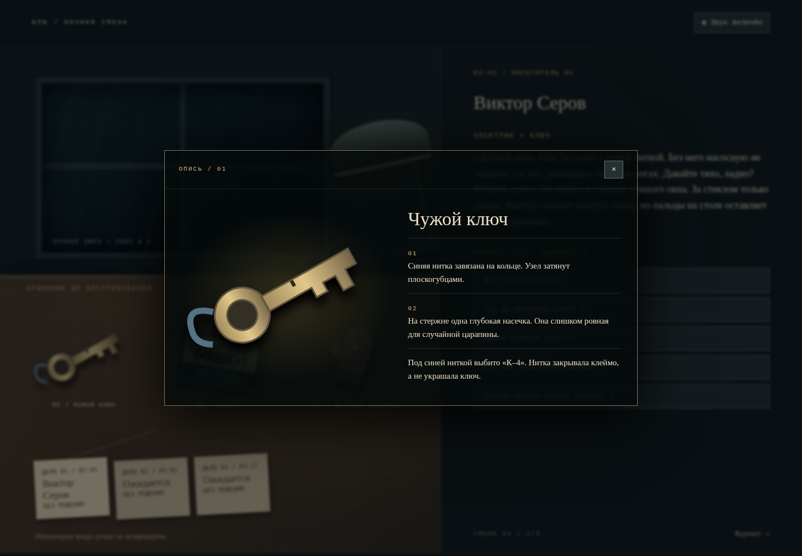

# Бюро пропавших вещей

Короткий браузерный триллер на русском языке. Одна ночная смена, три посетителя, три вещи и два финала.

**[Играть онлайн](https://vladsimbro.github.io/buro-propavshih-veshchey/)**

## Запуск

Откройте `index.html` в современном браузере. Вся игра, графика и синтез звука находятся в одном файле; внешние зависимости и сборка не нужны.

Осматривайте вещи, выбирайте по три вопроса каждому посетителю и решайте, возвращать ли находку. Скрытую примету можно запросить перед окончательным решением. Ответы и решения сохраняются в журнале и локальном хранилище браузера. Дождь и дверной колокольчик включаются кнопкой звука.

## Проверка

В Chromium через Playwright пройдены оба финала и все восемь сочетаний решений. Проверены переходы после решений, лимит вопросов, проверка скрытых примет, журнал, восстановление после перезагрузки, включение звука, мобильная ширина 390 px и закрытие осмотра клавишей Escape. Ошибок JavaScript не обнаружено. Звук на слух не оценивался.

## Скриншот

## Публикация

GitHub Pages публикует корень ветки `main`. Для обновления игры достаточно изменить `index.html` и отправить изменения в эту ветку.
